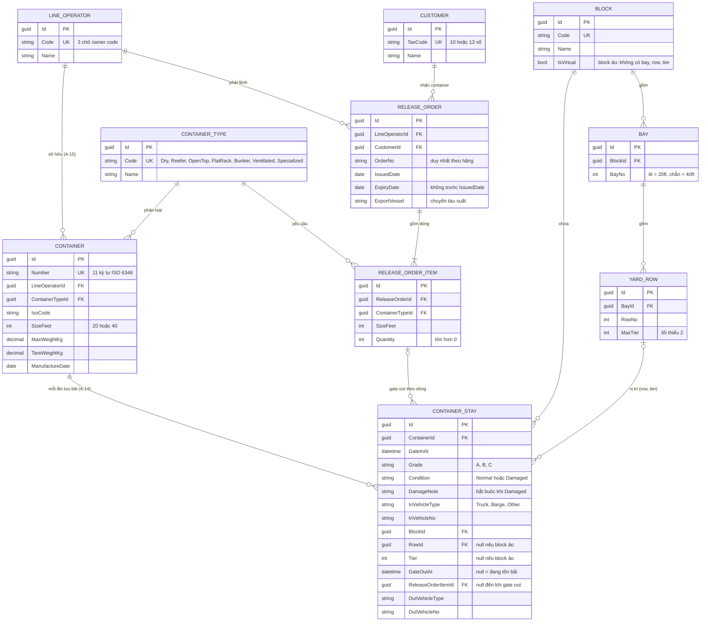

# ERD - Hệ thống quản lý Depot

Nguồn: `BR_DEPOT.md` (mã BR-xx, A-xx). Chưa có entity trong `src/`, nên ERD này là thiết kế đề xuất từ BR.

## Ghi chú thiết kế

- **Lần lưu bãi** (`CONTAINER_STAY`) gộp gate in và gate out: `GateOutAt IS NULL` là tồn bãi (BR-GI-03, BR-RP-02). Một container có nhiều stay (BR-GI-04), nhưng chỉ một stay đang mở.
- **Phương tiện** (A-12) là value object nhúng vào stay (`InVehicle*`, `OutVehicle*`), không tách bảng.
- **Vị trí**: block thường dùng `RowId` + `Tier`; block ảo để trống hai cột này (BR-YD-10, BR-YD-11). Ràng buộc "một vị trí một container" là unique index trên (`RowId`, `Tier`) với stay đang mở (BR-YD-05).
- **Bay lẻ/chẵn**: `BayNo` lẻ nhận 20ft, chẵn nhận 40ft; container 40ft ở bay chẵn chiếm hai bay lẻ liền kề (BR-YD-03, 04). Kiểm tra bằng rule, không thể hiện bằng khóa.
- **Gate out** gắn `ReleaseOrderItemId`; lệnh suy ra qua dòng. Kiểm tra hãng lệnh trùng hãng container (BR-GO-06), loại và kích thước khớp dòng (BR-GO-07), còn số lượng (BR-RO-06), chưa quá hạn (BR-RO-05) đều thuộc rule ở Application.
- **Trạng thái lệnh** (chưa giao, đang giao, đã giao đủ, quá hạn) là giá trị suy ra từ số stay đã gate out theo từng dòng và `ExpiryDate`, không lưu cột.
- **Unique index**: `CONTAINER(Number)`, `RELEASE_ORDER(LineOperatorId, OrderNo)` (A-10), `LINE_OPERATOR(Code)`, `CUSTOMER(TaxCode)`.
- **Unique index có điều kiện** (chỉ tính stay đang mở, `GateOutAt IS NULL`):
  - `CONTAINER_STAY(ContainerId)`: mỗi container chỉ một stay đang mở (BR-GI-03).
  - `CONTAINER_STAY(RowId, Tier)`: mỗi vị trí chỉ một container (BR-YD-05).
- **Unique index cấu trúc**: `BAY(BlockId, BayNo)`, `YARD_ROW(BayId, RowNo)`, `RELEASE_ORDER_ITEM(ReleaseOrderId, ContainerTypeId, SizeFeet)`.
- **Một depot**: hệ thống chỉ quản lý một depot nên không có bảng `DEPOT`. Nếu cần nhiều depot thì thêm `DEPOT` và `DepotId` vào `BLOCK`.
- **Xóa bãi**: Row đã từng có stay thì không cho xóa, để giữ lịch sử vị trí (BR-YD-08, BR-YD-09). Kiểm tra bằng rule ở Application.
- `Condition` chỉ nằm ở stay (ghi nhận lúc gate in), không lặp ở `CONTAINER`.
