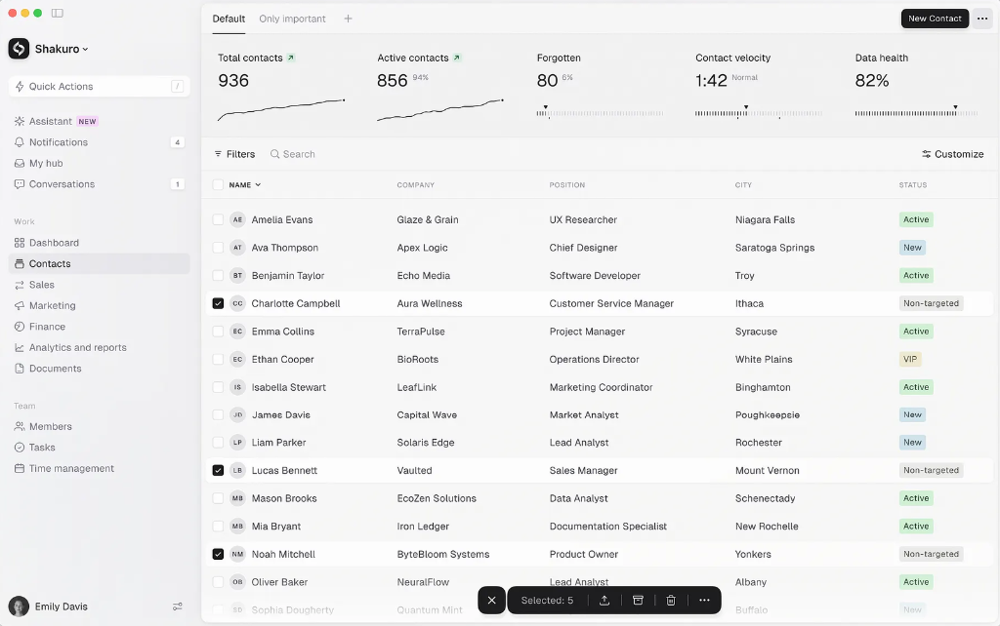

# DESIGN SYSTEM SPECIFICATION (`Design.md`)
**Codename:** Warm-Neutral Swiss Functionalism (Shakuro / Linear / Attio Craft Tier)  
**Scope:** Global Web UI Primitives, Tokens, Surfaces, Strokes, Elevations & Micro-Interactions *(Layout-Agnostic — Áp dụng cho toàn bộ Web App)*  
**Standard:** `/ui-ux-pro-max` Verified · Zero AI Slop



---

## 1. Triết Lý Thiết Kế Cốt Lõi & Định Hướng Thẩm Mỹ (Anti-AI Slop Philosophy)

Giao diện mẫu đạt độ tinh xảo cao nhờ áp dụng triết lý **Micro-Contrast Tonal Layering (Phân lớp Sắc độ Vi mô)** kết hợp **Swiss Typographic Precision**. Thay vì lạm dụng khung viền dày, đổ bóng đậm hay màu gradient sặc sỡ (những dấu hiệu đặc trưng của "AI Slop"), hệ thống vận hành dựa trên **5 nguyên lý bất biến**:

1. **Inverted Surface Elevation (Đảo ngược Độ nổi Bề mặt):**
   - Nền tổng thể của ứng dụng **không phải màu trắng tinh (`#FFFFFF`)** mà là một dải xám thạch anh ấm (Warm Alabaster / Stone Grey từ `#F1F1F1` đến `#F7F7F7`).
   - Màu trắng sáng (`#FDFDFD` – `#FFFFFF`) được **đặc quyền giữ lại** cho các phần tử đang có tương tác, đang được chọn (Selected/Active Card), ô nhập liệu chính (Quick Actions Input), hoặc huy hiệu đếm thông báo. Khi một phần tử chuyển sang `#FDFDFD` trên nền `#F7F7F7`, mắt người tự động nhận diện độ nổi mà chỉ cần một đường viền `1px` siêu mảnh và bóng đổ `2px` cực nhẹ.
2. **Card-on-Demand (Chỉ đóng khung khi có Trạng thái):**
   - Các dòng dữ liệu, danh sách, hay khối chỉ số (KPI) ở trạng thái mặc định **hoàn toàn trong suốt (`background: transparent`, `border: transparent`, `box-shadow: none`)** — không có đường kẻ ngang chia dòng kiểu bảng Excel truyền thống.
   - Phần tử chỉ "hiện hình" thành một **Elevated Card** (`background: #FDFDFD`, `border: 1px solid #EAEAEA`, `border-radius: 8px`) khi người dùng **Hover** hoặc **Select (Checked)**.
3. **Obsidian Focal Anchors (Điểm neo Đen Obsidian):**
   - Giữa không gian sắc độ sáng dịu (`#F1F1F1` – `#F7F7F7`), mọi hành động chính yếu nhất (Primary CTA Button, Checkbox đã chọn, Thanh công cụ nổi Floating Action Island, Logo thương hiệu, Điểm cuối biểu đồ) đều dùng màu **Đen Obsidian (`#1D1D1F`)** thay vì màu xanh dương hay tím công nghiệp. Điều này tạo ra tỷ lệ tương phản cực đại (>15:1) và dẫn hướng thị giác tức thì.
4. **Desaturated Botanical & Mineral Pastels (Màu Ngữ nghĩa Dịu nhẹ - Tương phản Chữ Sâu):**
   - Toàn bộ Status Badges (`Active`, `New`, `VIP`, `Non-targeted`, `NEW`) tuyệt đối không dùng nền đậm hay chữ phát sáng. Chúng sử dụng **nền Pastel pha xám khoáng chất** kết hợp với **màu chữ Rêu đậm / Than chì / Đồng cổ rất tối** (độ tương phản chữ > 7:1, đạt chuẩn AAA).
5. **Whisper-Quiet Hairlines (Đường kẻ Phân vùng 1px):**
   - Sự phân tách giữa các vùng chức năng dùng đường kẻ `1px solid #EBEBEB` (hoặc `#ECECEE`), chênh lệch đúng `4%–6%` độ sáng so với bề mặt nền — đủ để định hình cấu trúc nhưng không gây nhiễu thị giác.

> [!IMPORTANT]
> **Quy tắc Vàng Chống AI Slop:** Tuyệt đối **KHÔNG** bọc từng chỉ số KPI vào từng thẻ trắng có `box-shadow` riêng lẻ; **KHÔNG** dùng màu tím/xanh neon (`#6366F1`, `#3B82F6`) cho nút bấm chính; **KHÔNG** dùng `border-radius: 16px+` hay `9999px` cho thẻ và nhãn trạng thái; **KHÔNG** dùng `font-weight: 700/800` cho các con số thống kê lớn.

---

## 2. Hệ Thống Token Màu Sắc Chuẩn Xác (Exact Pixel-Sampled Color Tokens)

Mọi mã màu dưới đây được trích xuất trực tiếp từ dữ liệu pixel gốc của ảnh mẫu và chuẩn hóa thành biến CSS toàn cục.

### 2.1. Bề Mặt & Nền (Surface & Background Hierarchy)

| Token CSS | Mã HEX | RGB | Vai trò & Ngữ cảnh sử dụng (Áp dụng toàn Web) |
| :--- | :--- | :--- | :--- |
| `--bg-well-recessed` | `#F1F1F1` | `rgb(241, 241, 241)` | Vùng nền lõm nhẹ chứa các khối tổng hợp dữ liệu (KPI Strip, Summary Well, Code/Metric Well, Secondary Banner). |
| `--bg-surface-tinted` | `#F2F2F4` | `rgb(242, 242, 244)` | Bề mặt điều hướng phụ, Sidebar, Drawer phụ, hoặc vùng cài đặt bên (có ánh tím-xám lạnh cực nhẹ `1%`). |
| `--bg-canvas-default` | `#F7F7F7` | `rgb(247, 247, 247)` | **Nền chính (Primary Canvas)** của toàn bộ ứng dụng, vùng nội dung chính, danh sách, bảng, form nền. |
| `--bg-canvas-header` | `#F6F6F6` | `rgb(246, 246, 246)` | Nền thanh Top Bar, Sub-header, Filter Bar, Sticky Toolbar. |
| `--bg-surface-active-muted` | `#E7E6EB` | `rgb(231, 230, 235)` | Nền của mục điều hướng đang chọn (Active Nav Pill), nút phụ đang nhấn, hoặc vùng tab pill thu nhỏ. |
| `--bg-surface-control` | `#E5E5E8` | `rgb(229, 229, 232)` | Nền của nút Icon phụ (Secondary Icon Button như nút `•••`), nền Avatar chữ cái mặc định (`#E3E3E3` – `#E5E5E8`). |
| `--bg-surface-elevated` | `#FDFDFD` | `rgb(253, 253, 253)` | **Bề mặt nổi (Elevated Card / Active State):** Dùng cho Card/Row đang được chọn hoặc hover, Ô tìm kiếm/Quick Actions, Counter Chiclet, Dropdown Menu, Modal. |
| `--bg-surface-obsidian` | `#1D1D1F` | `rgb(29, 29, 31)` | **Bề mặt Tương phản Cao (Primary CTA & Command Island):** Nút hành động chính, Checkbox Checked, Floating Bulk Action Bar, Brand Mark. |

### 2.2. Màu Chữ & Biểu Tượng (Typography & Iconography Ink)

| Token CSS | Mã HEX | RGB | Độ tương phản (trên `#F7F7F7`) | Vai trò & Ngữ cảnh sử dụng |
| :--- | :--- | :--- | :--- | :--- |
| `--text-display-ink` | `#050505` | `rgb(5, 5, 5)` | `18.8 : 1` (AAA) | Con số KPI lớn (`936`, `856`, `82%`), tiêu đề lớn nhất. |
| `--text-primary` | `#18181A` | `rgb(24, 24, 26)` | `16.2 : 1` (AAA) | Tiêu đề mục đang chọn (`Contacts`, Tab `Default`), nhãn KPI (`Total contacts`), tên thương hiệu (`Shakuro`), tên người dùng. |
| `--text-body-strong` | `#39393B` | `rgb(57, 57, 59)` | `10.4 : 1` (AAA) | Nội dung chính trong danh sách/thẻ (Tên đối tượng, giá trị thuộc tính, chữ trong bảng). |
| `--text-secondary` | `#5B5A5F` | `rgb(91, 90, 95)` | `6.3 : 1` (AA+) | Mục điều hướng chưa chọn (`Dashboard`, `Sales`...), icon điều hướng phụ, nhãn số đếm. |
| `--text-muted` | `#8E8D92` | `rgb(142, 141, 146)` | `3.1 : 1` (UI/Sub) | Placeholder (`Quick Actions`, `Search`), Tab chưa chọn (`Only important`), Tiêu đề cột (`NAME`, `COMPANY`), chỉ số phụ superscript (`94%`, `Normal`). |
| `--text-overline` | `#A4A4A6` | `rgb(164, 164, 166)` | `2.3 : 1` (Decorative) | Nhãn phân nhóm tĩnh không tương tác (`Work`, `Team`), ký tự phím tắt (`/`). |
| `--text-on-obsidian` | `#FDFDFD` | `rgb(253, 253, 253)` | `16.5 : 1` (trên `#1D1D1F`) | Chữ và icon trên nút Primary `#1D1D1F`, trên Floating Action Bar và dấu tick Checkbox. |

### 2.3. Màu Ngữ Nghĩa & Trạng Thái (Semantic Badges & Micro-Chips)

> [!TIP]
> **Công thức phối màu Status Badge chuẩn Shakuro:** Không bao giờ dùng cùng một hue với `opacity: 0.1` và chữ neon. Hãy dùng **Nền Pastel đục (Opaque Pastel Tint)** kết hợp **Chữ Tối pha Đen (Deep Shade Ink)** cùng tông màu.

| Trạng thái (Semantic Role) | Nền (`background`) | Chữ / Icon (`color`) | Viền (`border`) | Ví dụ trong UI & Ý nghĩa áp dụng toàn Web |
| :--- | :--- | :--- | :--- | :--- |
| **Success / Active** | `#D1EFD4` | `#122D17` | `none` | Nhãn `Active`, trạng thái Hoàn thành, Đang hoạt động, Online, Đã xác thực. |
| **Positive Trend Chip (`↗`)** | `#D8EFE2` | `#203A23` | `none` | Chip mũi tên tăng trưởng `↗` cạnh tiêu đề KPI, chỉ báo tăng trưởng tích cực. |
| **Info / New / In-Progress** | `#CFE2ED` | `#2F4048` | `none` | Nhãn `New`, trạng thái Mới tạo, Đang xử lý, Bản nháp mới, Thông tin. |
| **Neutral / Non-Targeted** | `#EAEAE8` | `#2A2B28` | `none` | Nhãn `Non-targeted`, trạng thái Lưu trữ, Tạm dừng, Mặc định, Không phân loại. |
| **Warning / VIP / Premium** | `#ECEAD2` | `#423D24` | `none` | Nhãn `VIP`, trạng thái Ưu tiên cao, Sắp hết hạn, Cần chú ý, Gói cao cấp. |
| **Feature Promo / `NEW` Tag** | `#F3D6F8` | `#472E4F` | `none` | Nhãn `NEW` nhỏ cạnh tính năng AI/Assistant, tính năng Beta, thông báo mới. |
| **Danger / Destructive** *(Mở rộng đồng bộ)* | `#F5D6D6` | `#4A1C1C` | `none` | Trạng thái Lỗi, Quá hạn, Đã hủy, Cảnh báo xóa (tuân thủ đúng độ bão hòa và độ sáng của bộ màu gốc). |

### 2.4. Đường Viền, Nét Vẽ & Chia Cắt (Borders, Strokes & Dividers)

| Token CSS | Giá trị | Ngữ cảnh sử dụng |
| :--- | :--- | :--- |
| `--border-hairline` | `1px solid #EBEBEB` | Đường chia vùng ngang chính (dưới Top Bar, dưới KPI Strip, dưới Filter Bar, dưới Table Header). |
| `--border-sidebar-divider` | `1px solid #ECECEE` | Đường kẻ dọc ngăn cách vùng điều hướng và vùng nội dung. |
| `--border-card-selected` | `1px solid #EAEAEA` | Viền bao quanh Card / Dòng dữ liệu khi ở trạng thái Selected hoặc Hover (trên nền `#FDFDFD`). |
| `--border-input-subtle` | `1px solid #E6E5E8` | Viền ô Quick Actions, ô Input, hoặc nút Counter Chiclet (`4`, `1`). |
| `--border-checkbox-idle` | `1px solid #DCDCDD` | Viền Checkbox khi chưa chọn. |
| `--border-obsidian-inner` | `1px solid #38383A` | Viền phản quang bên trong (inner specular border) của Floating Action Bar `#1D1D1F`. |
| `--border-obsidian-halo` | `2px solid #F7F7F7` | Viền sáng bao ngoài (outer cutout halo) giúp thanh công cụ tối `#1D1D1F` tách biệt sắc nét khỏi các dòng dữ liệu bên dưới. |
| `--divider-on-obsidian` | `1px solid rgba(255, 255, 255, 0.16)` | Vạch ngăn dọc (`height: 14px`) bên trong Floating Action Bar tối. |

---

## 3. Hệ Thống Typography & Quy Tắc Chữ (Typography Scale & OpenType Discipline)

### 3.1. Font Stack & OpenType Features
- **Primary Sans Font Family:**
  ```css
  --font-sans: 'Inter', 'Plus Jakarta Sans', -apple-system, BlinkMacSystemFont, 'SF Pro Text', 'Segoe UI', sans-serif;
  --font-display: 'Inter Display', 'Plus Jakarta Sans', -apple-system, BlinkMacSystemFont, 'SF Pro Display', sans-serif;
  --font-mono: 'JetBrains Mono', 'SF Mono', ui-monospace, monospace;
  ```
- **Thiết lập hiển thị bắt buộc trên `body`:**
  ```css
  body {
    font-family: var(--font-sans);
    -webkit-font-smoothing: antialiased;
    -moz-osx-font-smoothing: grayscale;
    text-rendering: optimizeLegibility;
    font-feature-settings: "cv02", "cv03", "cv04", "cv11";
  }
  ```
- **Quy tắc số học (`tabular-nums`):** Mọi con số thống kê (`936`, `856`, `1:42`, `82%`), số đếm badge (`4`, `1`, `Selected: 5`), và cột dữ liệu số bắt buộc có `font-variant-numeric: tabular-nums` để không bị nhảy độ rộng khi cập nhật dữ liệu.

### 3.2. Thang Đo Chữ Chuẩn (Type Scale — Chuẩn 1440px Desktop)

| Cấp độ (Token) | Kích thước (`font-size`) | Độ đậm (`font-weight`) | Chiều cao dòng (`line-height`) | Khoảng cách chữ (`letter-spacing`) | Màu mặc định | Ứng dụng cụ thể |
| :--- | :--- | :--- | :--- | :--- | :--- | :--- |
| **`display-metric`** | `28px` (`1.75rem`) | `500` *(Medium)* | `1.15` (`32px`) | `-0.03em` | `#050505` | Số KPI lớn (`936`, `856`, `80`, `1:42`, `82%`). **Lưu ý:** Dùng weight `500`, tuyệt đối không dùng `700`/`800`. |
| **`brand-title`** | `14px` (`0.875rem`) | `600` *(SemiBold)* | `1.25` (`18px`) | `-0.015em` | `#18181A` | Tên Workspace (`Shakuro`), tiêu đề Modal/Drawer. |
| **`ui-body-medium`** | `13px` (`0.8125rem`) | `500` *(Medium)* | `1.4` (`18px`) | `-0.01em` | `#18181A` | Mục Nav đang chọn (`Contacts`), Tab đang chọn (`Default`), Tên chính trong dòng được chọn (`Charlotte Campbell`). |
| **`ui-body-regular`** | `13px` (`0.8125rem`) | `400` *(Regular)* | `1.4` (`18px`) | `-0.005em` | `#39393B` | Chữ chuẩn trong toàn bộ ứng dụng: Nhãn KPI (`Total contacts`), ô dữ liệu (`Glaze & Grain`, `UX Researcher`), mục Nav thường. |
| **`ui-control-label`** | `12.5px` (`0.78125rem`) | `500` *(Medium)* | `1.2` (`15px`) | `-0.005em` | `#18181A` / `#FDFDFD` | Chữ trong nút bấm (`New Contact`, `Filters`, `Customize`, `Selected: 5`). |
| **`badge-status`** | `11.5px` (`0.71875rem`) | `500` *(Medium)* | `1.0` | `0em` | Theo Semantic | Chữ trong nhãn trạng thái (`Active`, `New`, `Non-targeted`, `VIP`) — viết hoa chữ cái đầu (Sentence case). |
| **`metric-superscript`** | `11px` (`0.6875rem`) | `500` *(Medium)* | `1.0` | `0em` | `#8E8D92` | Chỉ số phụ đặt lệch lên góc trên bên phải số KPI lớn (`94%`, `6%`, `Normal`). |
| **`section-overline`** | `11px` (`0.6875rem`) | `500` *(Medium)* | `1.2` | `0em` | `#A4A4A6` | Tiêu đề nhóm điều hướng (`Work`, `Team`) — viết hoa chữ cái đầu, không in hoa toàn bộ. |
| **`table-header-cap`** | `10px` (`0.625rem`) | `600` *(SemiBold)* | `1.2` | `+0.06em` | `#8C8C8E` | Tiêu đề cột dữ liệu (`NAME`, `COMPANY`, `POSITION`, `CITY`, `STATUS`) — `text-transform: uppercase`. |
| **`micro-tag-caps`** | `9.5px` (`0.59375rem`) | `700` *(Bold)* | `1.0` | `+0.04em` | `#472E4F` / `#39393B` | Chữ viết tắt trong Avatar (`AE`, `CC`) và nhãn `NEW` tím cạnh Assistant. |

---

## 4. Phân Tích & Trích Xuất Từng Component (Component-Level Specifications)

Mọi thông số dưới đây quy định hình thái, kích thước, khoảng đệm, đường viền và đổ bóng của từng nguyên tử giao diện (UI Primitives) để tái sử dụng ở bất kỳ trang nào.

### 4.1. Hệ Thống Nút Bấm (Buttons & Interactive Controls)

#### A. Primary Solid Button (Nút Hành Động Chính — VD: `New Contact`)
- **Hình thái:** Hình chữ nhật bo góc vừa phải (`border-radius: 6px`), tuyệt đối không bo tròn dạng viên thuốc (`9999px`).
- **Thông số CSS chuẩn:**
  ```css
  .btn-primary {
    height: 28px; /* 30px ở mật độ thoải mái */
    padding: 0 12px;
    border-radius: 6px;
    background-color: #1D1D1F;
    color: #FDFDFD;
    font-size: 12px;
    font-weight: 500;
    letter-spacing: -0.01em;
    border: 1px solid #121214;
    box-shadow: 
      inset 0 1px 0 rgba(255, 255, 255, 0.14),
      0 1px 2px rgba(0, 0, 0, 0.10);
    transition: background-color 150ms ease, transform 100ms ease, box-shadow 150ms ease;
  }
  .btn-primary:hover {
    background-color: #2C2C2E;
  }
  .btn-primary:active {
    background-color: #121214;
    transform: translateY(0.5px);
    box-shadow: inset 0 1px 2px rgba(0, 0, 0, 0.25);
  }
  ```

#### B. Secondary Tonal Icon Button (Nút Icon Phụ — VD: Nút `•••` góc phải trên)
- **Hình thái:** Nút vuông bo góc `6px`, nằm cạnh Primary Button với khoảng cách `gap: 6px`.
- **Thông số CSS chuẩn:**
  ```css
  .btn-icon-tonal {
    width: 28px;
    height: 28px;
    border-radius: 6px;
    background-color: #E5E5E8;
    color: #262628;
    border: none;
    display: inline-flex;
    align-items: center;
    justify-content: center;
    transition: background-color 150ms ease, color 150ms ease;
  }
  .btn-icon-tonal:hover {
    background-color: #DADADE;
    color: #121214;
  }
  ```

#### C. Ghost Utility Button (Nút Công Cụ Trong Suốt — VD: `Filters`, `Customize`, `+`)
- **Hình thái:** Không nền, không viền ở trạng thái nghỉ; gồm Icon mảnh (`14px × 14px`, `stroke-width: 1.5px`) + Nhãn chữ `12.5px` cách nhau `gap: 6px`.
- **Thông số CSS chuẩn:**
  ```css
  .btn-ghost-utility {
    height: 28px;
    padding: 0 8px;
    border-radius: 6px;
    background: transparent;
    border: 1px solid transparent;
    color: #1D1D1F;
    font-size: 12.5px;
    font-weight: 500;
    display: inline-flex;
    align-items: center;
    gap: 6px;
    transition: background-color 140ms ease;
  }
  .btn-ghost-utility svg {
    width: 14px;
    height: 14px;
    stroke-width: 1.5px;
    color: #39393B;
  }
  .btn-ghost-utility:hover {
    background-color: rgba(0, 0, 0, 0.045);
  }
  .btn-ghost-utility:active {
    background-color: rgba(0, 0, 0, 0.075);
  }
  ```

#### D. Brand / Workspace Switcher Button (VD: `Shakuro ⌄`)
- **Cấu trúc:**
  1. **Brand Squircle Avatar:** `26px × 26px`, `border-radius: 7px`, nền `#1D1D1F`, chứa biểu tượng vector màu trắng `#FDFDFD`, đổ bóng nhẹ `0 1px 2px rgba(0,0,0,0.12)`.
  2. **Brand Label:** `14px`, `font-weight: 600`, màu `#18181A`, cách logo `8px`.
  3. **Chevron Down:** Icon `12px × 12px`, `stroke-width: 1.75px`, màu `#8E8D92`, cách chữ `4px`.

---

### 4.2. Thanh Điều Hướng & Tab (Navigation Items & Tab Indicators)

#### A. Navigation Item Pill (Mục Điều Hướng Dọc — VD: `Dashboard`, `Contacts`)
- **Chiều cao & Đệm:** `height: 30px` (hoặc `32px`), `padding: 0 10px`, `border-radius: 6px`, `gap: 9px` giữa icon và chữ.
- **Icon:** Vector nét mảnh `15px × 15px`, `stroke-width: 1.4px`, không tô đặc (outline-only).
- **Trạng thái Inactive (`Dashboard`, `Sales`...):**
  - `background: transparent`
  - `color: #5B5A5F` (cả icon và chữ)
  - `font-weight: 400`
  - **Hover:** `background: rgba(0, 0, 0, 0.035)`, `color: #18181A`.
- **Trạng thái Active (`Contacts`):**
  - `background: #E7E6EB` (tím-xám khói cực nhẹ, không dùng viền hay vạch dọc bên trái)
  - `color: #18181A` (cả icon và chữ chuyển sang đậm nét)
  - `font-weight: 500`

#### B. Underline View Tabs (Tab Chuyển Đổi Góc Nhìn — VD: `Default`, `Only important`, `+`)
- **Cấu trúc:** Các tab đặt cách nhau `gap: 20px`, chiều cao vùng tab `40px`.
- **Tab Active (`Default`):**
  - Chữ `13px`, `font-weight: 500`, màu `#18181A`.
  - **Thanh gạch chân (Active Indicator):** Chiều cao `1.5px` (hoặc `2px`), màu `#2F2F2F`, rộng bằng đúng chiều dài chữ của tab (`width: 100%` của text), nằm đè trực tiếp lên đường kẻ ngang `--border-hairline` (`#EBEBEB`).
- **Tab Inactive (`Only important`):**
  - Chữ `13px`, `font-weight: 400`, màu `#8E8D92`, không có gạch chân. Hover chuyển màu chữ sang `#39393B`.

---

### 4.3. Ô Nhập Liệu, Tìm Kiếm & Phím Tắt (Inputs, Search & Keycaps)

#### A. Elevated Command Input (`⚡ Quick Actions [/]`)
- **Đặc trưng thiết kế:** Là phần tử nổi bật trên nền `#F2F2F4` nhờ bề mặt trắng `#FDFDFD`, viền mảnh và bóng đổ vi mô.
- **Thông số CSS chuẩn:**
  ```css
  .command-input-trigger {
    height: 32px;
    padding: 0 6px 0 10px;
    border-radius: 7px;
    background-color: #FDFDFD;
    border: 1px solid #E6E5E8;
    box-shadow: 0 1px 2px rgba(0, 0, 0, 0.03);
    display: flex;
    align-items: center;
    justify-content: space-between;
    color: #8E8D92;
    font-size: 12.5px;
    transition: border-color 150ms ease, box-shadow 150ms ease;
  }
  .command-input-trigger:hover,
  .command-input-trigger:focus-within {
    border-color: #CFCFD4;
    box-shadow: 0 2px 4px rgba(0, 0, 0, 0.05);
  }
  ```
- **Shortcut Keycap (`/`):**
  ```css
  .kbd-shortcut {
    width: 18px;
    height: 18px;
    border-radius: 4px;
    background-color: #F7F7F8;
    border: 1px solid #E5E5E7;
    color: #8E8D92;
    font-family: var(--font-sans);
    font-size: 10px;
    font-weight: 500;
    display: inline-flex;
    align-items: center;
    justify-content: center;
  }
  ```

#### B. Inline Borderless Search (`🔍 Search`)
- **Đặc trưng:** Không khung viền, không nền trắng riêng biệt khi chưa focus — hòa làm một với thanh công cụ `#F6F6F6`.
- **Cấu trúc:** Icon kính lúp `13.5px × 13.5px` (`color: #8E8D92`, `stroke-width: 1.5px`) + Input trong suốt (`font-size: 12.5px`, placeholder `#8E8D92`, chữ khi gõ `#18181A`, `gap: 6px`).

---

### 4.4. Thẻ Dữ Liệu, Thẻ KPI & Hiệu Ứng Nổi (Cards, Data Rows & Surface Containers)

#### A. Borderless Metric Block (Khối Chỉ Số KPI Không Viền)
- **Nguyên tắc:** Không dùng `background: #FFFFFF` hay `border` cho từng khối KPI riêng lẻ. Các khối KPI nằm chung trong một dải nền lõm `--bg-well-recessed` (`#F1F1F1`), giới hạn trên và dưới bởi đường kẻ `1px solid #EBEBEB`.
- **Cấu trúc 3 tầng bên trong mỗi Metric Block:**
  1. **Tầng 1 (Header):** Nhãn chỉ số (`13px`, `#18181A`, `font-weight: 400`) + Chip xu hướng tùy chọn (`↗` `16px × 16px`, bo góc `4px`, nền `#D8EFE2`, icon `#203A23`, cách nhãn `6px`).
  2. **Tầng 2 (Value + Superscript):** Cách tầng 1 `6px`. Con số chính (`28px`, `#050505`, `font-weight: 500`) + Chỉ số phụ (`94%`, `6%`, `Normal` ở cỡ `11px`, màu `#8E8D92`, đặt ở vị trí superscript cao ngang đỉnh chữ số lớn, cách bên phải `6px`).
  3. **Tầng 3 (Micro-Chart):** Cách tầng 2 `14px`. Chiều cao vùng biểu đồ `24px–28px`, chiều rộng `130px–150px`.

#### B. Stateful Row Card (Thẻ Dòng Dữ Liệu Có Trạng Thái — Điểm Đắt Giá Nhất Của UI)
- **Trạng thái Mặc định (Unselected / Idle):**
  - Chiều cao: `36px` (khoảng cách tâm giữa 2 dòng là `40px`, tạo khe hở `4px` giữa các dòng).
  - Nền: `transparent` (hiển thị trực tiếp nền `--bg-canvas-default` `#F7F7F7`).
  - Viền: `1px solid transparent` (giữ chỗ sẵn để không bị giật layout khi chuyển sang Selected).
  - Bo góc: `border-radius: 8px`.
  - Đường kẻ ngang giữa các dòng: **KHÔNG CÓ (`none`)**.
- **Trạng thái Hover (Khi di chuột qua dòng chưa chọn):**
  - Nền: `rgba(255, 255, 255, 0.55)` hoặc `#FAFAFA`.
  - Viền: `1px solid #EFEFEF`.
- **Trạng thái Selected / Active Card (VD: Dòng `Charlotte Campbell`, `Lucas Bennett`, `Noah Mitchell`):**
  ```css
  .data-row-card.is-selected {
    background-color: #FDFDFD;
    border: 1px solid #EAEAEA;
    border-radius: 8px;
    box-shadow: 
      inset 0 1px 0 rgba(255, 255, 255, 0.9),
      0 1px 2px rgba(0, 0, 0, 0.035);
  }
  .data-row-card.is-selected .row-primary-text {
    color: #18181A;
    font-weight: 500;
  }
  ```

#### C. Bottom Viewport Scroll-Fade Scrim (Lớp Mờ Chân Trang Tinh Tế)
- Ở mép dưới cùng của vùng danh sách (dòng `Sophia Dougherty`), giao diện áp dụng một lớp phủ mờ dần (`height: 44px`) để báo hiệu còn nội dung bên dưới và làm nổi bật thanh Floating Action Bar:
  ```css
  .viewport-bottom-fade {
    position: sticky;
    bottom: 0;
    height: 44px;
    pointer-events: none;
    background: linear-gradient(
      180deg,
      rgba(247, 247, 247, 0) 0%,
      rgba(247, 247, 247, 0.78) 65%,
      #F7F7F7 100%
    );
  }
  ```

---

### 4.5. Huy Hiệu, Nhãn Trạng Thái & Số Đếm (Badges, Pills & Counter Chiclets)

#### A. Semantic Status Badge (`Active`, `New`, `Non-targeted`, `VIP`)
- **Hình thái:** Hình chữ nhật bo góc mềm (`border-radius: 5px`), **không bo tròn 999px**, **không có chấm tròn (dot) phía trước**, **không có viền (`border: none`)**.
- **Thông số CSS chuẩn:**
  ```css
  .status-badge {
    display: inline-flex;
    align-items: center;
    justify-content: center;
    height: 22px;
    padding: 0 8px;
    border-radius: 5px;
    font-size: 11.5px;
    font-weight: 500;
    line-height: 1;
    white-space: nowrap;
    border: none;
  }
  .status-badge--active       { background: #D1EFD4; color: #122D17; }
  .status-badge--new          { background: #CFE2ED; color: #2F4048; }
  .status-badge--non-targeted { background: #EAEAE8; color: #2A2B28; }
  .status-badge--vip          { background: #ECEAD2; color: #423D24; }
  ```

#### B. Promo Feature Micro-Tag (`NEW` cạnh Assistant)
- **Thông số CSS chuẩn:**
  ```css
  .badge-promo-new {
    display: inline-flex;
    align-items: center;
    height: 16px;
    padding: 0 5px;
    border-radius: 4px;
    background-color: #F3D6F8;
    color: #472E4F;
    font-size: 9.5px;
    font-weight: 700;
    letter-spacing: 0.04em;
    text-transform: uppercase;
  }
  ```

#### C. Notification Counter Chiclet (`4`, `1` ở Sidebar)
- **Hình thái:** Khác với Status Badge không viền, số đếm thông báo là một **viên gạch nổi màu trắng (`#FDFDFD`)** có viền mảnh như một phím nhỏ.
- **Thông số CSS chuẩn:**
  ```css
  .counter-chiclet {
    min-width: 18px;
    height: 18px;
    padding: 0 5px;
    border-radius: 4px;
    background-color: #FDFDFD;
    border: 1px solid #E5E4E8;
    box-shadow: 0 1px 1px rgba(0, 0, 0, 0.025);
    color: #5B5A5F;
    font-size: 11px;
    font-weight: 500;
    font-variant-numeric: tabular-nums;
    display: inline-flex;
    align-items: center;
    justify-content: center;
  }
  ```

---

### 4.6. Checkbox & Avatar (Selection Controls & Identity Primitives)

#### A. Squircle Checkbox
- **Kích thước:** `15px × 15px` (hoặc `16px × 16px`), `border-radius: 4px`.
- **Trạng thái Unchecked:**
  - `background-color: #FDFDFD`
  - `border: 1px solid #DCDCDD`
  - `box-shadow: inset 0 1px 1px rgba(0, 0, 0, 0.02)`
- **Trạng thái Checked:**
  - `background-color: #1D1D1F`
  - `border: 1px solid #1D1D1F`
  - Icon dấu tick màu `#FDFDFD`, nét vẽ `stroke-width: 1.8px`, bo đầu nét (`stroke-linecap: round; stroke-linejoin: round`).

#### B. Monogram Initials Avatar (`AE`, `AT`, `BT`, `CC`...)
- **Kích thước:** Hình tròn `24px × 24px` (`border-radius: 50%`).
- **Màu nền & Chữ:**
  - Nền: `#E3E3E3` (khi nằm trên dòng thường) hoặc `#EAEAEA` (khi nằm trên dòng đang chọn `#FDFDFD`).
  - Chữ: 2 ký tự in hoa (`9.5px`, `font-weight: 600`, `letter-spacing: 0.02em`, màu `#39393B`).
  - Không dùng màu sắc cầu vồng ngẫu nhiên cho từng avatar chữ cái — giữ sự đồng nhất, tĩnh lặng tuyệt đối cho bảng dữ liệu.

#### C. User Profile Avatar (`Emily Davis`)
- **Kích thước:** `26px × 26px`, `border-radius: 50%`, `object-fit: cover`, có viền trong chống lẹm `box-shadow: inset 0 0 0 1px rgba(0, 0, 0, 0.08)`.

---

### 4.7. Thanh Công Cụ Hành Động Hàng Loạt Nổi (Floating Bulk Action Island)

Đây là thành phần mang tính biểu tượng cao nhất về mặt kỹ thuật chế tác (Craftsmanship) trong ảnh mẫu:

- **Kiến trúc Split-Module (Tách 2 khối độc lập):**
  Thay vì làm 1 thanh dài duy nhất, thanh công cụ nổi gồm **2 khối màu Đen Obsidian (`#1D1D1F`) đặt cạnh nhau**, cách nhau một khe hở `gap: 4px`:
  1. **Khối Trái (Nút Đóng / Bỏ chọn `[ ✕ ]`):** Hình vuông bo góc `38px × 38px`, `border-radius: 9px`, chứa icon `✕` (`14px × 14px`, màu `#FDFDFD`).
  2. **Khối Phải (Thanh Tác vụ `[ Selected: 5 | ↑ | ⊟ | 🗑 | ••• ]`):** Cao `38px`, `border-radius: 9px`, `padding: 0 6px 0 14px`, chứa nhãn `Selected: 5` (`12.5px`, `font-weight: 500`, `#FDFDFD`) và 4 nút icon (`32px × 30px` mỗi vùng bấm, icon `15px × 15px`, `#FDFDFD`).
- **Thanh ngăn dọc bên trong (Internal Dividers):** Giữa chữ `Selected: 5` và giữa từng nút icon đều có một vạch dọc `width: 1px; height: 14px; background: rgba(255, 255, 255, 0.16)`.
- **Vật lý Viền Kép & Đổ bóng (Double-Ring Halo & Shadow):**
  ```css
  .floating-island-module {
    background-color: #1D1D1F;
    color: #FDFDFD;
    border-radius: 9px;
    /* Viền phản quang mờ bên trong khối đen */
    border: 1px solid #38383A;
    /* Viền sáng cắt lớp bên ngoài giúp tách khối đen khỏi chữ/dòng bên dưới */
    outline: 2px solid #F7F7F7;
    box-shadow: 
      0 10px 24px -4px rgba(0, 0, 0, 0.18),
      0 3px 8px -2px rgba(0, 0, 0, 0.12);
  }
  ```

---

### 4.8. Biểu Đồ Vi Mô (Micro-Data Visualizations: Sparklines & Barcode Gauges)

Giao diện sử dụng 2 dạng biểu đồ vi mô tối giản, hoàn toàn dùng màu đơn sắc (`#1D1D1F` / `#262628` và `#D4D4D6`), **không dùng trục tọa độ, không dùng lưới (gridlines), không tô màu gradient dưới đường biểu đồ**:

#### A. Minimalist Polyline Sparkline (Dùng cho số lượng / xu hướng liên tục)
- **Đường biểu diễn (Line):** SVG `<path>` hoặc `<polyline>` với `stroke: #262628`, `stroke-width: 1.25px`, `fill: none`, `stroke-linecap: round`, `stroke-linejoin: round`.
- **Điểm kết thúc (Terminal Dot):** Tại tọa độ điểm cuối cùng bên phải `(x_last, y_last)`, đặt một chấm tròn đặc `<circle r="2" fill="#1D1D1F" />` (đường kính `4px`) để neo điểm nhìn.

#### B. Barcode Ruler Tick Gauge (Thước Vạch Chia Độ — Dùng cho Tỷ lệ %, Tốc độ, Điểm sức khỏe)
- **Cấu trúc:** Một hàng ngang gồm `34–38` vạch thẳng đứng (`width: 1px`, `height: 6px`, khoảng cách giữa các vạch `gap: 3px`).
- **Vạch đã đạt (Active/Filled Ticks):** `background-color: #262628`.
- **Vạch chưa đạt (Remaining/Track Ticks):** `background-color: #D0D0D3`.
- **Kim chỉ thị ngưỡng (Threshold Needle & Caret):**
  Tại vị trí giá trị hiện tại (ví dụ: `6%`, `1:42`, `82%`), vạch tại vị trí đó **kéo dài gấp đôi** (`height: 12px`, `background-color: #1D1D1F`) và phía trên đỉnh vạch có một **tam giác nhỏ trỏ xuống (`▼`)** kích thước `5px × 4px` màu `#1D1D1F` (cách đỉnh vạch `1px`).

---

## 5. Ma Trận Độ Nổi, Viền & Đổ Bóng (Elevation, Stroke & Shadow Physics)

Hệ thống tuyệt đối tránh các bóng đổ lớn mờ nhạt kiểu cũ (`0 4px 20px rgba(0,0,0,0.1)`). Thay vào đó, chỉ có **4 cấp độ Độ nổi (Elevation Tiers)**:

| Cấp độ | Tên Token | Giá trị `box-shadow` & `border` | Áp dụng cho Component nào |
| :--- | :--- | :--- | :--- |
| **Tier 0 (Flat / Recessed)** | `--elevation-0` | `border: none; box-shadow: none;` | KPI Blocks, Unselected Data Rows, Inactive Nav Items, Ghost Buttons, Inline Search. |
| **Tier 1 (Micro-Tactile)** | `--elevation-1` | `border: 1px solid #E6E5E8;`<br>`box-shadow: 0 1px 2px rgba(0, 0, 0, 0.03);` | Quick Actions Input, Counter Chiclets (`4`, `1`), Unchecked Checkbox (`#DCDCDD`). |
| **Tier 2 (Selected Card)** | `--elevation-2` | `border: 1px solid #EAEAEA;`<br>`box-shadow: inset 0 1px 0 rgba(255, 255, 255, 0.9), 0 1px 2px rgba(0, 0, 0, 0.035);` | Selected Data Row Card (`#FDFDFD`), Active Dropdown Card, Popover nhẹ. |
| **Tier 3 (Primary CTA)** | `--elevation-3` | `border: 1px solid #121214;`<br>`box-shadow: inset 0 1px 0 rgba(255, 255, 255, 0.14), 0 1px 2px rgba(0, 0, 0, 0.10);` | Primary Obsidian Button (`New Contact`). |
| **Tier 4 (Floating Island)** | `--elevation-4` | `border: 1px solid #38383A;`<br>`outline: 2px solid #F7F7F7;`<br>`box-shadow: 0 10px 24px -4px rgba(0, 0, 0, 0.18), 0 3px 8px -2px rgba(0, 0, 0, 0.12);` | Floating Bulk Action Island (`Selected: 5` bar), Command Palette Modal, Toast Notification tối. |

---

## 6. Hệ Thống Bo Góc & Nhịp Khoảng Cách (Border Radius & Spacing Tokens)

### 6.1. Quy Tắc Bo Góc Đồng Tâm (Concentric Border Radius Scale)
Không dùng các giá trị bo góc ngẫu nhiên. Toàn bộ hệ thống chỉ dùng 5 nấc bo góc:
- `--radius-xs: 4px` → Checkbox (`15×15px`), Keycap (`/`), Counter Chiclet (`4`, `1`), Promo Badge (`NEW`), Trend Chip (`↗`).
- `--radius-sm: 5px` → Semantic Status Badges (`Active`, `New`, `Non-targeted`, `VIP`).
- `--radius-md: 6px` → Primary Button (`New Contact`), Secondary Icon Button (`•••`), Ghost Buttons, Sidebar Nav Items.
- `--radius-lg: 7px` → Quick Actions Input, Brand Logo Squircle (`Shakuro`).
- `--radius-xl: 8px–9px` → Selected Data Row Card (`8px`), Floating Bulk Action Island (`9px`).
- `--radius-full: 9999px` → **CHỈ** dùng cho Avatar hình tròn (`AE`, `Emily Davis`), tuyệt đối không dùng cho Buttons hay Badges.

### 6.2. Nhịp Khoảng Cách Nội Khu (Internal Component Spacing)
- Khoảng cách giữa Icon và Text trong Button / Nav Item: `6px–8px`.
- Khoảng cách giữa Checkbox → Avatar → Tên chính: `12px` (`Checkbox` → `12px` → `Avatar 24px` → `10px` → `Text`).
- Khoảng cách giữa 2 nút cạnh nhau trên thanh công cụ: `6px`.
- Khoảng cách dọc giữa các mục điều hướng: `2px–4px`.
- Khoảng cách dọc giữa các thẻ dòng dữ liệu: `4px` (chiều cao thẻ `36px` trên bước nhảy dòng `40px`).

---

## 7. Quy Tắc Tương Tác, Chuyển Động & Accessibility (`/ui-ux-pro-max` Standards)

1. **Thời lượng & Đường cong Chuyển động (Micro-Interaction Timing):**
   - Hover màu nền / viền: `140ms cubic-bezier(0.22, 1, 0.36, 1)`.
   - Chuyển trạng thái chọn dòng (Row Selection Card): `160ms ease-out`.
   - Xuất hiện thanh Floating Action Island: `240ms cubic-bezier(0.16, 1, 0.3, 1)` (`translateY(12px) scale(0.97)` → `translateY(0) scale(1)`).
   - Bắt buộc hỗ trợ `@media (prefers-reduced-motion: reduce)` để tắt hiệu ứng trượt khi người dùng yêu cầu.
2. **Focus Ring Chuẩn Accessibility:**
   - Không bao giờ xóa `outline` mà không có trạng thái thay thế.
   - Khi điều hướng bằng bàn phím (`:focus-visible`), hiển thị vòng focus sắc nét:
     ```css
     :focus-visible {
       outline: 2px solid #1D1D1F;
       outline-offset: 2px;
     }
     ```
3. **Vùng Bấm Tối Thiểu & Con Trỏ:**
   - Mọi phần tử tương tác (`button`, `row checkbox`, `tab`, `nav item`, `action icon`) phải có `cursor: pointer` và vùng nhận diện click tối thiểu (dùng `padding` hoặc pseudo-element `::after` mở rộng vùng hit-target cho checkbox `16px` lên `32px × 32px`).
4. **Iconography Discipline:**
   - Sử dụng duy nhất 1 bộ icon vector nét mảnh đồng nhất (Lucide Icons / Phosphor Regular / SF Symbols) với `stroke-width: 1.4px - 1.5px`.
   - Tuyệt đối không dùng Emoji (🚀, 🔥, ✅) thay cho icon hệ thống.

---

## 8. Bộ Biến CSS Toàn Cục Sẵn Sàng Tích Hợp (Ready-to-Use CSS Custom Properties)

Sao chép khối `:root` dưới đây vào file stylesheet gốc (`globals.css` / `tokens.css`) của dự án để áp dụng toàn bộ ngôn ngữ thiết kế này ngay lập tức:

```css
:root {
  /* 1. Surfaces & Backgrounds */
  --bg-well-recessed: #F1F1F1;
  --bg-surface-tinted: #F2F2F4;
  --bg-canvas-header: #F6F6F6;
  --bg-canvas-default: #F7F7F7;
  --bg-surface-active-muted: #E7E6EB;
  --bg-surface-control: #E5E5E8;
  --bg-surface-control-hover: #DADADE;
  --bg-surface-elevated: #FDFDFD;
  --bg-surface-obsidian: #1D1D1F;
  --bg-surface-obsidian-hover: #2C2C2E;
  --bg-avatar-monogram: #E3E3E3;

  /* 2. Typography & Ink */
  --text-display-ink: #050505;
  --text-primary: #18181A;
  --text-body-strong: #39393B;
  --text-secondary: #5B5A5F;
  --text-muted: #8E8D92;
  --text-overline: #A4A4A6;
  --text-on-obsidian: #FDFDFD;

  /* 3. Semantic Status Tokens (Pastel Surface + Deep Ink) */
  --status-active-bg: #D1EFD4;
  --status-active-text: #122D17;
  --status-trend-bg: #D8EFE2;
  --status-trend-text: #203A23;
  --status-new-bg: #CFE2ED;
  --status-new-text: #2F4048;
  --status-neutral-bg: #EAEAE8;
  --status-neutral-text: #2A2B28;
  --status-vip-bg: #ECEAD2;
  --status-vip-text: #423D24;
  --status-promo-bg: #F3D6F8;
  --status-promo-text: #472E4F;
  --status-danger-bg: #F5D6D6;
  --status-danger-text: #4A1C1C;

  /* 4. Borders, Hairlines & Dividers */
  --border-hairline: #EBEBEB;
  --border-sidebar-divider: #ECECEE;
  --border-card-selected: #EAEAEA;
  --border-input-subtle: #E6E5E8;
  --border-checkbox-idle: #DCDCDD;
  --border-obsidian-inner: #38383A;
  --border-obsidian-halo: #F7F7F7;
  --divider-on-obsidian: rgba(255, 255, 255, 0.16);

  /* 5. Chart & Gauge Primitives */
  --chart-stroke-primary: #262628;
  --chart-node-primary: #1D1D1F;
  --chart-tick-active: #262628;
  --chart-tick-inactive: #D0D0D3;

  /* 6. Radii */
  --radius-xs: 4px;
  --radius-sm: 5px;
  --radius-md: 6px;
  --radius-lg: 7px;
  --radius-xl: 8px;
  --radius-island: 9px;
  --radius-full: 9999px;

  /* 7. Shadows & Elevations */
  --shadow-micro-input: 0 1px 2px rgba(0, 0, 0, 0.03);
  --shadow-selected-card: inset 0 1px 0 rgba(255, 255, 255, 0.9), 0 1px 2px rgba(0, 0, 0, 0.035);
  --shadow-primary-btn: inset 0 1px 0 rgba(255, 255, 255, 0.14), 0 1px 2px rgba(0, 0, 0, 0.10);
  --shadow-floating-island: 0 10px 24px -4px rgba(0, 0, 0, 0.18), 0 3px 8px -2px rgba(0, 0, 0, 0.12);
}
```

---

## 9. Bảng Kiểm Tra Chống AI Slop Trước Khi Xuất Bản (Anti-AI Slop Guardrail Checklist)

| Dấu hiệu "AI Slop" (CẤM TUYỆT ĐỐI) | Chuẩn Thiết Kế Shakuro (`Design.md` — BẮT BUỘC) |
| :--- | :--- |
| Nền trang trắng toát `#FFFFFF` và các thẻ xám `#F3F4F6` | Nền trang xám thạch anh ấm `#F7F7F7`, dải KPI `#F1F1F1`, và chỉ thẻ đang chọn/input mới có màu trắng `#FDFDFD`. |
| Đóng khung từng thẻ KPI với viền dày và `box-shadow` lớn | KPI hoàn toàn không có khung riêng, nằm chung trên dải nền `#F1F1F1`, phân tách bằng khoảng trắng và đường kẻ `1px solid #EBEBEB`. |
| Kẻ đường ngang `1px` giữa tất cả các dòng trong danh sách/bảng | Danh sách không có đường kẻ ngang chia dòng; chỉ dòng được chọn/hover mới nổi lên thành thẻ `#FDFDFD` bo góc `8px` có viền `#EAEAEA`. |
| Nút bấm chính màu xanh/tím gradient (`#4F46E5`, `#2563EB`) | Nút bấm chính, Checkbox đã chọn, và Floating Bar dùng màu Đen Obsidian `#1D1D1F` với chữ `#FDFDFD`. |
| Status Badge bo tròn `9999px`, có chấm tròn ở đầu, màu neon | Status Badge bo góc vuông mềm `5px`, không chấm tròn, không viền, nền Pastel khoáng chất (`#D1EFD4`, `#CFE2ED`, `#ECEAD2`) + chữ tối sâu (`#122D17`, `#2F4048`, `#423D24`). |
| Số KPI dùng chữ siêu đậm `font-weight: 700` hoặc `800` | Số KPI lớn (`28px`) dùng đúng `font-weight: 500` (Medium), `letter-spacing: -0.03em`, kèm chỉ số phụ `11px` `#8E8D92` ở góc trên phải. |
| Biểu đồ mini có tô vùng màu gradient mờ bên dưới đường kẻ | Sparkline chỉ là 1 đường nét mảnh `1.25px` màu `#262628` + 1 chấm tròn `4px` ở điểm cuối, hoặc thước vạch Barcode `1px` kèm mũi tên chỉ thị `▼`. |

---

## 10. Áp Dụng Trong Dự Án Depot (Tailwind 4, `web/src/styles.css`)

Các mục 2 đến 8 là đặc tả gốc. Trong `web/` token nằm trong khối `@theme` của `src/styles.css` (không dùng `:root` hay CSS tự viết), và chỉ dùng qua tiện ích Tailwind. Không viết mã hex, không dùng giá trị tùy ý như `p-[13px]`. Cần giá trị chưa có ở đây thì dừng lại và hỏi, không tự thêm.

### 10.1. Bảng quy đổi token

| Đặc tả (mục 2 đến 6) | Lớp Tailwind | Ghi chú |
| :--- | :--- | :--- |
| `--bg-canvas-default` `#F7F7F7` | `bg-shell` | Nền trang |
| `--bg-surface-elevated` `#FDFDFD` | `bg-surface` | Dòng chọn/hover, ô nhập, popover, drawer, dialog |
| `--bg-well-recessed` `#F1F1F1` | `bg-surface-sunken` | Dải KPI, vùng lõm, ô trống trên sơ đồ bãi |
| `--bg-surface-tinted` `#F2F2F4` | `bg-sidebar` | Sidebar |
| `--bg-canvas-header` `#F6F6F6` | `bg-topbar` | Top bar, thanh bộ lọc |
| `--bg-surface-active-muted` `#E7E6EB` | `bg-nav-active` | Mục menu đang chọn |
| `--bg-surface-control` `#E5E5E8` | `bg-control` (`hover:bg-control-hover`) | Nút icon phụ, avatar mặc định |
| `--bg-surface-obsidian` `#1D1D1F` | `bg-brand` (`hover:bg-brand-hover`, `active:bg-brand-press`) | Nút chính, checkbox chọn, thanh nổi. Tên `brand` giữ lại, giá trị là obsidian |
| `--text-display-ink` | `text-ink-display` | Số KPI lớn |
| `--text-primary` | `text-ink` | Tiêu đề, mục đang chọn |
| `--text-body-strong` | `text-ink-body` | Nội dung dòng dữ liệu |
| `--text-secondary` | `text-ink-2` | Chữ phụ cần đọc được |
| `--text-muted` | `text-ink-3` | **Chỉ** placeholder, tab chưa chọn, tiêu đề cột. Dưới 4,5:1 nên không dùng cho chữ cần đọc |
| `--text-overline` | `text-ink-overline` | **Chỉ** nhãn nhóm menu và phím tắt, mang tính trang trí |
| `--text-on-obsidian` | `text-on-brand` | Chữ trên nền obsidian |
| Status badge | `bg-success-bg text-success-fg` và tương tự cho `info`, `neutral`, `warning`, `promo`, `danger` | Không chấm, không viền |
| `--border-hairline` | `border-line` | Mọi đường kẻ vùng |
| `--border-card-selected` | `border-line-card` | Dòng chọn/hover |
| `--border-input-subtle` | `border-line-input` (`hover:border-line-strong`) | Ô nhập, chiclet |
| `--border-checkbox-idle` | `border-line-check` | Checkbox chưa chọn |
| Bo góc `xs` 4, `sm` 5, `md` 6, `lg` 7, `xl` 8, island 9 | `rounded-xs`, `rounded-chip`, `rounded-control`, `rounded-field`, `rounded-card`, `rounded-island` | `rounded-inset` 8 cho vùng lõm. `rounded-full` chỉ cho avatar |
| Elevation 1 đến 4 | `shadow-hairline`, `shadow-raised`, `shadow-primary`, `shadow-popover` | `popover` là tier 4 (thanh nổi, drawer, dialog) |
| Cỡ chữ | `text-metric`, `text-title`, `text-section`, `text-card`, `text-body`, `text-small`, `text-caption`, `text-note`, `text-label`, `text-micro` | Xem 10.2 |

### 10.2. Thang chữ trong Tailwind

| Lớp | Cỡ / dòng | Tương ứng mục 3.2 |
| :--- | :--- | :--- |
| `text-metric` | 28 / 32, weight 500, -0.03em | `display-metric` |
| `text-title` | 20 / 28, weight 600, -0.02em | Tiêu đề trang. **Mở rộng của dự án**, đặc tả gốc không có |
| `text-section` | 14 / 18, weight 600, -0.015em | `brand-title`: tiêu đề dialog, drawer, workspace |
| `text-card` | 13 / 18, weight 500 | `ui-body-medium` |
| `text-body` | 13 / 18 | `ui-body-regular` |
| `text-small` | 12.5 / 15 | `ui-control-label`: chữ nút, ô nhập |
| `text-caption` | 11.5 / 14 | `badge-status` và chữ phụ nhỏ |
| `text-note` | 11 / 14 | `metric-superscript`, `section-overline` (không in hoa) |
| `text-label` | 10 / 12, weight 600, +0.06em | `table-header-cap`, luôn kèm `uppercase` |
| `text-micro` | 9.5 / 12, weight 700, +0.04em | `micro-tag-caps`: chữ viết tắt avatar, nhãn `NEW` |

Số liệu luôn dùng `tabular-nums`. Font là Inter Variable với `cv02 cv03 cv04 cv11` bật sẵn.

### 10.3. Quy ước áp dụng của dự án

- **Danh sách và bảng** nằm thẳng trên nền `bg-shell`, không bọc thẻ, không kẻ ngang giữa dòng. Dòng cao 36px, cách nhau 4px, thành thẻ `bg-surface` + `border-line-card` + `shadow-raised` khi hover hoặc chọn. Chỗ trống giữ `border border-transparent` để không giật layout.
- **Form** dùng nhóm có viền hairline bo 8px; ô nhập là phần tử trắng `bg-surface` có viền `border-line-input`.
- **Chiều cao control:** từ breakpoint `sm` trở lên là 28px (nút, tab, nav item 30px); dưới `sm` là 40px để chạm bằng ngón tay.
- **Sơ đồ bãi:** ô trống dùng `bg-surface-sunken`, ô có container dùng `bg-surface` + `border-line-card`, ô đang chọn dùng `bg-brand` chữ `text-on-brand`. Tồn lâu dùng chip `warning`, hư hỏng dùng chip `danger`.
- Không thêm thành phần của spec mà app chưa có chức năng (dải KPI, sparkline, thanh hành động hàng loạt, Quick Actions) cho đến khi có tính năng cần tới.
